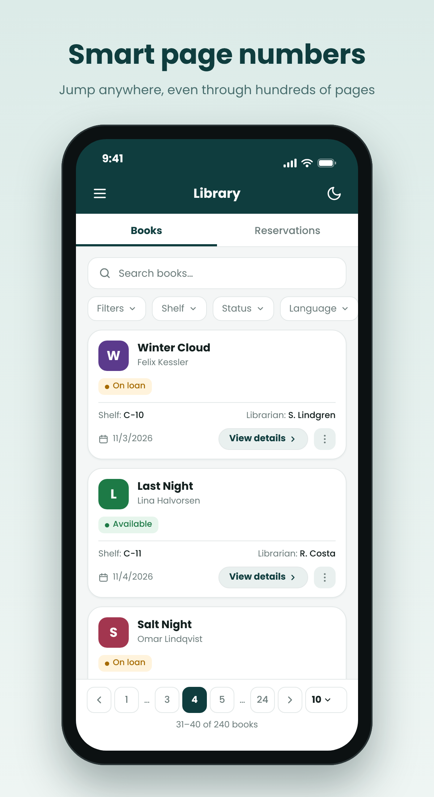
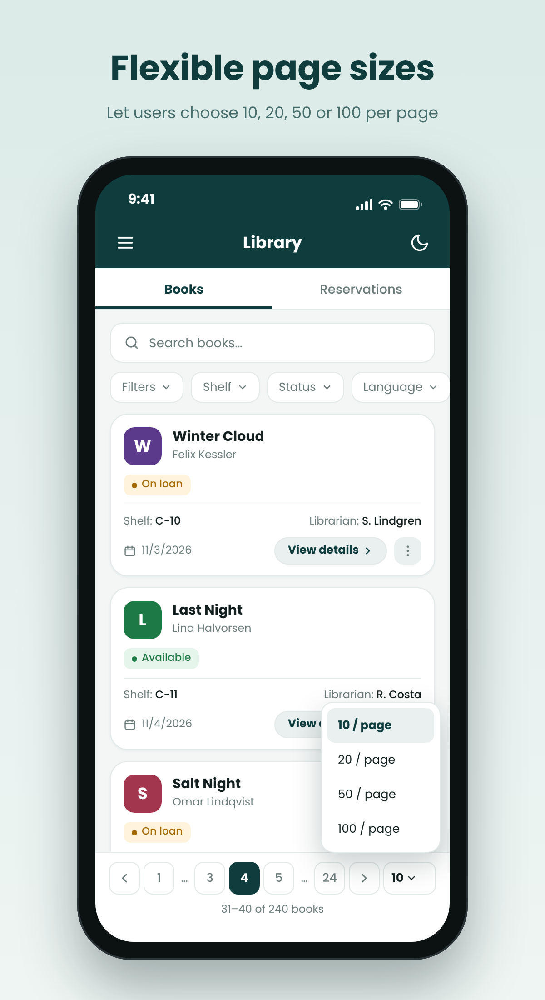
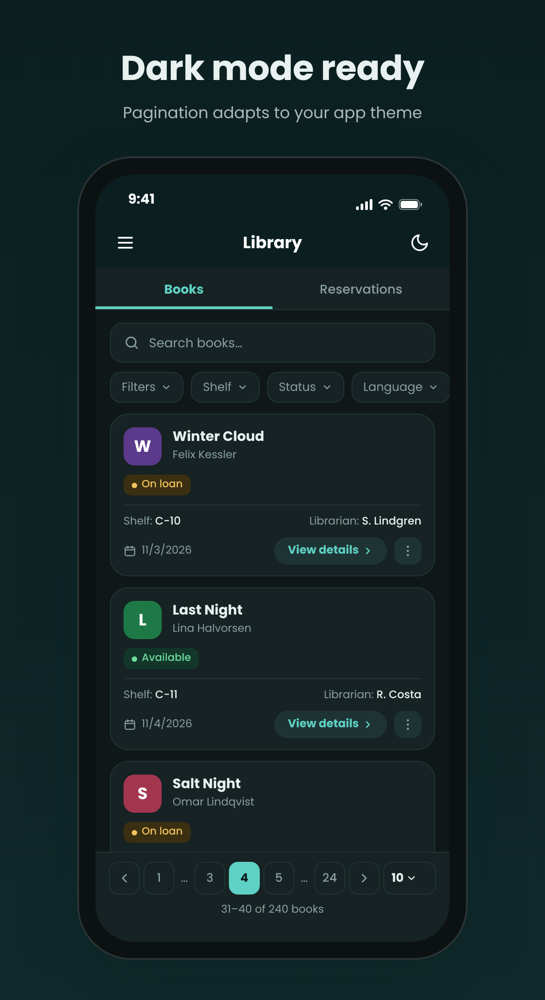
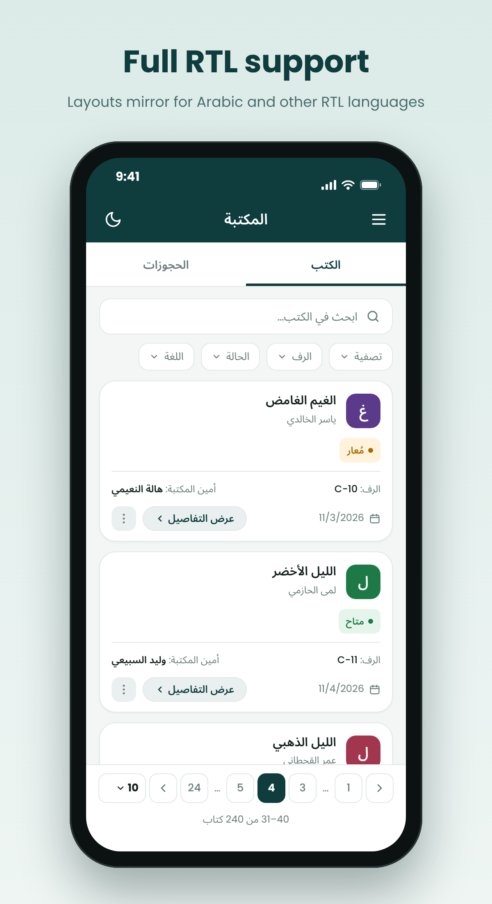
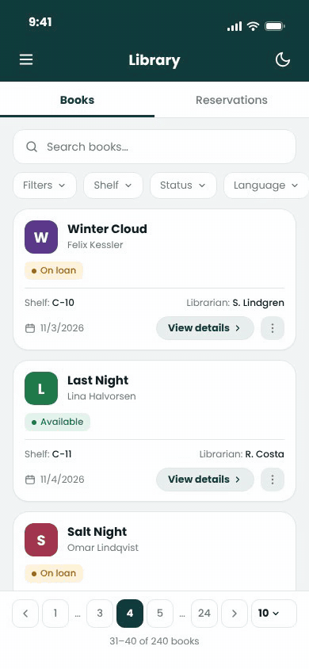

# Compact Pagination

A compact, theme-aware page-number control for Flutter. It shows previous and
next buttons, a bounded set of page numbers with ellipses, an optional
page-size menu, and an optional item range summary.

The package has no third-party runtime dependencies. It reads colors and text
styles from the active Flutter `ThemeData` and follows the current text
direction, including RTL layouts.

## Screenshots

| Page navigation | Page-size selection |
| --- | --- |
|  |  |
| Dark theme | Arabic right-to-left layout |
|  |  |

### Animated demo



## Installation

After publishing, add the package to your app:

```sh
flutter pub add compact_pagination
```

Or add it to `pubspec.yaml` manually:

```yaml
dependencies:
  compact_pagination: ^0.1.3
```

## Usage

```dart
import 'package:compact_pagination/compact_pagination.dart';

AppPagination(
  currentPage: currentPage,
  totalPages: totalPages,
  totalItems: totalItems,
  rowsPerPage: rowsPerPage,
  onPageChanged: (page) => setState(() => currentPage = page),
  onRowsPerPageChanged: (size) {
    setState(() {
      rowsPerPage = size;
      currentPage = 1;
    });
  },
  itemLabel: 'members',
)
```

For API pagination, calculate `totalPages` from the server's total count and
current page size. Keep the current page and page size in your app's state
management layer; this widget only displays controls and sends callbacks.

## Localization

Pass translated labels for the buttons and page-size menu. Use
`itemsInfoBuilder` to translate or reorder the summary for your locale:

```dart
AppPagination(
  // Required pagination values and callbacks...
  previousPageTooltip: 'Previous',
  nextPageTooltip: 'Next',
  rowsPerPageTooltip: 'Items per page',
  perPageLabel: 'per page',
  pageLabelBuilder: (page) => 'Page $page',
  itemsInfoBuilder: ({startItem, endItem, totalItems, itemLabel}) =>
      '$startItem–$endItem of $totalItems $itemLabel',
)
```

## Options

| Option | Default | Purpose |
| --- | --- | --- |
| `rowsPerPageOptions` | `[10, 20, 50, 100]` | Values in the page-size menu |
| `maxVisiblePages` | `5` | Maximum page-number buttons, including first and last |
| `itemLabel` | `items` | Noun used in the range summary |
| `showItemsInfo` | `true` | Show the range summary |
| `showRowsPerPage` | `true` | Show the page-size selector |
| `showTopBorder` | `true` | Show a divider above the control |
| `padding` | `EdgeInsets.only(top: 8)` | Outer padding |

See `example/lib/main.dart` for a complete runnable example.

## License

BSD 3-Clause. See the [LICENSE](LICENSE) file.
